<div align="center">

<a href="https://nimd.me">
  
</a>

<a href="https://github.com/nimdme">
  
</a>

<br>

<a href="https://nimd.me"></a>
<a href="https://nimd.me/blog"></a>
<a href="https://nimd.me/journal"></a>
<a href="https://nimd.me/resume"></a>

<a href="https://nimd.me/?email"></a>
<a href="https://go.nimd.me/linkedin"></a>
<a href="https://go.nimd.me/yt"></a>

</div>

<p align="center">
  
</p>

## whoami

```console
$ whoami
niranjan: systems, infrastructure, software, research

$ cat ~/interests
linux  homelabs  networking  backend  tools-i-did-not-need-to-build

$ echo $FREE_TIME
music, coffee, a journal that is mostly half-finished thoughts

$ man niranjan
I like understanding how things work under the hood,
and occasionally breaking them to find out.
```

<p align="center">
  
</p>

## What I spend my time on

<table>
<tr>
<td width="50%" valign="top">
<h4>Systems and infrastructure</h4>
<p>Linux, homelabs, and networking. I like the layer of a computer where things stop being magic and start being files, sockets, and processes you can poke at.</p>
</td>
<td width="50%" valign="top">
<h4>Software and tools</h4>
<p>Backend systems, plus small tools that solve problems I probably could have avoided. They usually turn into the best way to learn something.</p>
</td>
</tr>
<tr>
<td width="50%" valign="top">
<h4>Research mindset</h4>
<p>Read the docs, then read the source, then break it on purpose. If I can't explain how it works, I haven't finished learning it.</p>
</td>
<td width="50%" valign="top">
<h4>Off the clock</h4>
<p>Making music, drinking coffee, and writing in my journal. Some of that ends up on the <a href="https://nimd.me/journal">journal page</a>, most of it doesn't.</p>
</td>
</tr>
</table>

<p align="center">
  
</p>

## Tools I reach for

<!-- Edit this list to match what you actually use: https://skillicons.dev -->
<p align="center">
  
</p>

<p align="center">
  
</p>

## On GitHub

<p align="center">
  
  
</p>

<p align="center">
  
</p>

<!-- Needs the garden.yml workflow in .github/workflows/ to generate the output branch -->
<p align="center">
  
</p>

<p align="center">
  
</p>

<div align="center">

*If it works and you don't know why, that's the interesting part.*

<sub>Find the long version at <a href="https://nimd.me">nimd.me</a></sub>

</div>